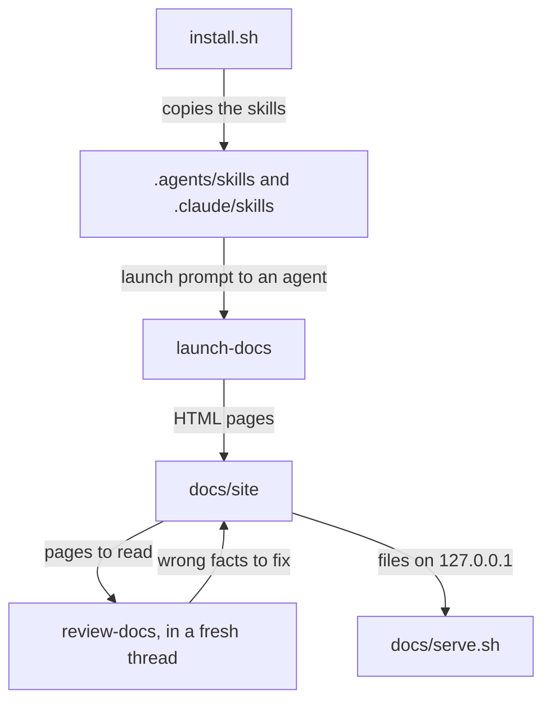

# Docsite harness

Four agent skills and a one-line prompt build a static docs site for a git repo, then review its pages against the code.



## Install and launch

The site has no build step or framework. Serving it takes Python 3, and the visual checks take Chrome or Chromium.

```bash
git clone https://github.com/a-barwick/docsite-harness.git
```

```bash
docsite-harness/install.sh /path/to/repo
```

Send this to an agent running in that repo:

> Use the launch-docs skill to build this repo's docs site, then run it with docs/serve.sh and give me the URL.

## Review after every launch

Send this in a fresh thread:

> Use the review-docs skill to review the site. Report findings only.

In the last trial, three sites passed `check.py` with no failures. A review against the code then found 49 wrong facts across their 37 pages.

`PROMPT.md` has the prompt for adding a page.

## Skills

| Skill | What it does |
| --- | --- |
| `launch-docs` | Reads the repo, plans the pages, copies the site files, writes the pages and checks them. |
| `write-docs` | Adds or changes one page, and chooses where it goes. |
| `review-docs` | Checks a page against the code and the page rules, using `check.py`. |
| `plain-writing` | Lists the sentence rules, with lines that past reviews rejected. |

## Files added to a repo

| File | Contents | Varies by repo |
| --- | --- | --- |
| `docs/site/AGENTS.md` | Page rules, with the project's example and colors | Yes |
| `docs/site/site-config.js` | Site name and navigation | Yes |
| `docs/site/site.js` | Navigation, step maps and Data buttons | No |
| `docs/site/site.css` | Styles | Only if a page needs a style the shared file lacks |
| `docs/serve.sh` | Local web server | No |

## What `check.py` finds

| Check | Examples |
| --- | --- |
| Facts | A source path that doesn't exist, a code name that isn't in the repo, a Data panel citing a missing file |
| Layout | Sideways scrolling at 1440 and 375 px, script errors, broken images, broken links |
| Diagrams | Lines crossing boxes or text, text leaving its box, text too small on a phone, a part drawn twice on the overview |
| Writing | Slogans, praise words, long paragraphs, text describing the site itself |
| Privacy | Email addresses, API keys, home directory paths, private network addresses, deploy preview hostnames |

`check.py` can't judge whether a sentence is true, so a clean run doesn't replace the review.

## Agent permissions

Viewing a page starts Chrome. Muse's sandbox blocks Chrome, so Muse needs its sandbox off to view its pages. In Codex's sandbox, the first render failed and later renders in the same run succeeded.

The trials ran these commands in throwaway worktrees. Most of them turn off permission prompts.

| Agent | Command |
| --- | --- |
| Claude Code | `claude -p --permission-mode bypassPermissions` |
| Codex | `codex exec --sandbox workspace-write` |
| Muse | `muse exec --trust-workspace --disable-approval --disable-sandbox` |
| Grok | `grok -p --always-approve` |

<details>
<summary>Running a trial</summary>

```bash
trials/run.sh ROUND /path/to/repo opus
```

```bash
trials/score.py ROUND
```

```bash
trials/clean.sh /path/to/repo
```

| Script | What it does |
| --- | --- |
| `run.sh` | Makes a worktree in `../docsite-trials/ROUND` and sends the launch prompt to `opus`, `astra`, `wonder` or `grok`. |
| `score.py` | Prints what a script can measure, and saves the checks and screenshots to `trials/results/`. It doesn't check whether the facts are right. |
| `clean.sh` | Removes the worktrees and their `docsite-trial/*` branches. |

</details>

## License

MIT. See `LICENSE`.
